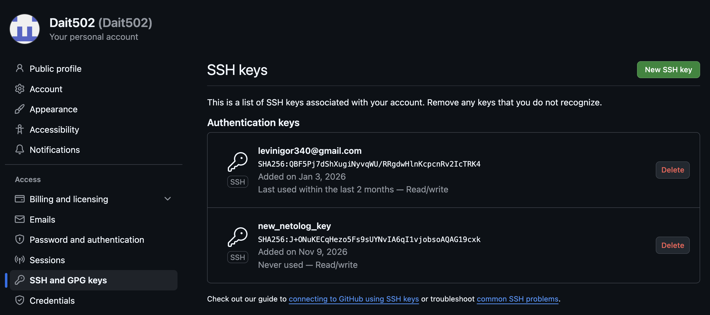

# ДЗ 3. Настройка SSH-доступа к GitHub

**Студент:** Игорь Левин · **Преподаватель:** Михаил Меркушов  
**Репозиторий:** [https://github.com/Dait502/netolog_ssh_hw3](https://github.com/Dait502/netolog_ssh_hw3)

Система: macOS (Darwin 24.6.0), OpenSSH 9.9p2, git 2.50.1.

---

## 1. Установка SSH-клиента и генерация ключевой пары

### 1.1. Проверка наличия SSH-клиента

На macOS OpenSSH входит в систему, устанавливать отдельно не нужно.

```bash
which ssh ssh-keygen
ssh -V
```

```text
$ which ssh ssh-keygen
/usr/bin/ssh
/usr/bin/ssh-keygen
$ ssh -V
OpenSSH_9.9p2, LibreSSL 3.3.6
```

### 1.2. Генерация ключа ed25519 с passphrase

```bash
ssh-keygen -t ed25519 -C "levinigor340@gmail.com" -f ~/.ssh/id_ed25519
```

При генерации задана непустая passphrase (вводится дважды, в отчёт не попадает).

Ключ создан в `~/.ssh/id_ed25519` (приватный) и `~/.ssh/id_ed25519.pub` (публичный). Ранее существовавший ключ без пароля сохранён как `id_ed25519_old`.

### 1.3. Проверка, что ключи лежат в `~/.ssh/` и приватный ключ защищён паролем

```bash
ls -la ~/.ssh/
ssh-keygen -lf ~/.ssh/id_ed25519.pub     # отпечаток публичного ключа
```

```text
$ ls -la ~/.ssh/
total 64
drwx------  10 igor  staff   320 Nov  9 17:59 .
drwxr-x---+ 56 igor  staff  1792 Nov  9 18:05 ..
-rw-------@  1 igor  staff   109 Feb 14  2026 authorized_keys
-rw-------@  1 igor  staff   142 Nov  9 17:51 config
-rw-------   1 igor  staff   464 Nov  9 17:59 id_ed25519
-rw-r--r--   1 igor  staff   104 Nov  9 17:59 id_ed25519.pub
-rw-------@  1 igor  staff   419 Jan  3  2026 id_ed25519_old
-rw-r--r--@  1 igor  staff   104 Jan  3  2026 id_ed25519_old.pub
-rw-------@  1 igor  staff  3225 May 12 15:32 known_hosts
-rw-------@  1 igor  staff  1883 May  1  2026 known_hosts.old

$ ssh-keygen -lf ~/.ssh/id_ed25519.pub
256 SHA256:J+ONuKECqHezo5Fs9sUYNvIA6qI1vjobsoAQAG19cxk levinigor340@gmail.com (ED25519)
```

Проверка passphrase: попытка прочитать приватный ключ с пустым паролем должна завершиться ошибкой.

```bash
ssh-keygen -y -P "" -f ~/.ssh/id_ed25519
```

```text
$ ssh-keygen -y -P "" -f ~/.ssh/id_ed25519
Load key "~/.ssh/id_ed25519": incorrect passphrase supplied to decrypt private key
```

Права доступа: приватный ключ `600` (`-rw-------`), публичный `644` (`-rw-r--r--`).

### 1.4. Настройка ssh-agent и Keychain

Чтобы не вводить passphrase при каждом подключении, ключ добавлен в ssh-agent с сохранением пароля в связке ключей macOS. Файл `~/.ssh/config`:

```text
Host github.com
  HostName github.com
  User git
  IdentityFile ~/.ssh/id_ed25519
  IdentitiesOnly yes
  AddKeysToAgent yes
  UseKeychain yes
```

```bash
ssh-add --apple-use-keychain ~/.ssh/id_ed25519
ssh-add -l
```

```text
$ ssh-add -l
256 SHA256:J+ONuKECqHezo5Fs9sUYNvIA6qI1vjobsoAQAG19cxk levinigor340@gmail.com (ED25519)
```

Passphrase вводится один раз при добавлении в агент; дальше git и ssh используют ключ без запроса пароля.

---

## 2. Добавление публичного ключа в аккаунт GitHub

```bash
pbcopy < ~/.ssh/id_ed25519.pub
```

Содержимое `~/.ssh/id_ed25519.pub`:

```text
ssh-ed25519 AAAAC3NzaC1lZDI1NTE5AAAAIPLtpb8WE0S7uTbHD43AX0fhB+xCtqJgauNouke872aq levinigor340@gmail.com
```

Ключ добавлен в **GitHub → Settings → SSH and GPG keys → New SSH key** (тип: Authentication Key).



Отпечаток на странице GitHub совпадает с выводом `ssh-keygen -lf` из п. 1.3.

---

## 3. Проверка SSH-подключения к GitHub

```bash
ssh -T git@github.com
```

```text
$ ssh -T git@github.com
Hi Dait502! You've successfully authenticated, but GitHub does not provide shell access.

$ ssh -v -T git@github.com 2>&1 | grep -E "Offering|accepts|Authenticated"
debug1: Offering public key: ~/.ssh/id_ed25519 ED25519 SHA256:J+ONuKECqHezo5Fs9sUYNvIA6qI1vjobsoAQAG19cxk explicit agent
debug1: Server accepts key: ~/.ssh/id_ed25519 ED25519 SHA256:J+ONuKECqHezo5Fs9sUYNvIA6qI1vjobsoAQAG19cxk explicit agent
Authenticated to github.com ([140.82.121.4]:22) using "publickey".
```

GitHub вернул приветствие с именем пользователя: аутентификация по ключу прошла, пароль не запрашивался.

---

## 4. Работа с репозиторием по SSH

### 4.1. Клонирование по SSH-URL

```bash
git clone git@github.com:Dait502/netolog_ssh_hw3.git
```

```text
$ git clone git@github.com:Dait502/netolog_ssh_hw3.git
Cloning into 'netolog_ssh_hw3'...
```

```bash
git remote -v
```

```text
$ git remote -v
origin	git@github.com:Dait502/netolog_ssh_hw3.git (fetch)
origin	git@github.com:Dait502/netolog_ssh_hw3.git (push)
```

### 4.2. Коммит и push

```bash
git add README.md screenshots/
git commit -m "Отчёт по ДЗ3: настройка SSH-доступа к GitHub"
git push origin main
```

```text
$ git push origin main
To github.com:Dait502/netolog_ssh_hw3.git
   deb6b78..3cb92df  main -> main
```

`git push` выполнился без ввода логина и пароля: используется SSH-ключ из ssh-agent.

---

## Итог

| Шаг | Результат |
|---|---|
| SSH-клиент | OpenSSH 9.9p2 есть в системе |
| Ключ | ed25519, защищён passphrase, лежит в `~/.ssh/` |
| GitHub | публичный ключ добавлен в Settings → SSH and GPG keys |
| `ssh -T git@github.com` | приветствие `Hi Dait502!` |
| clone / commit / push | по SSH-URL, без запроса пароля |
